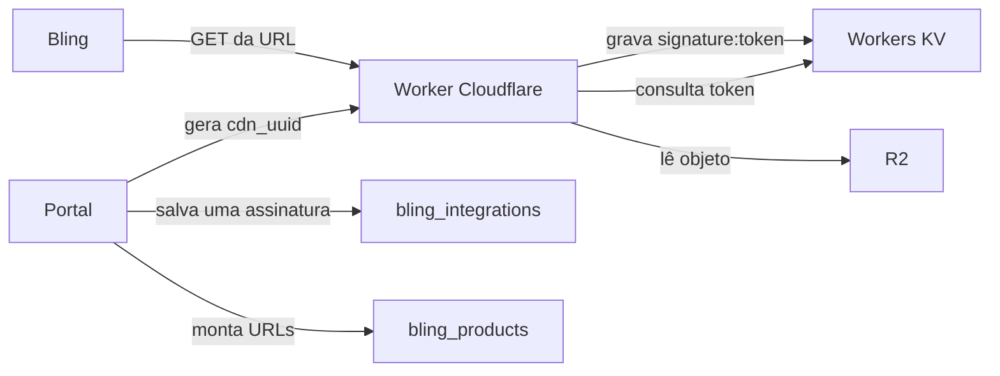
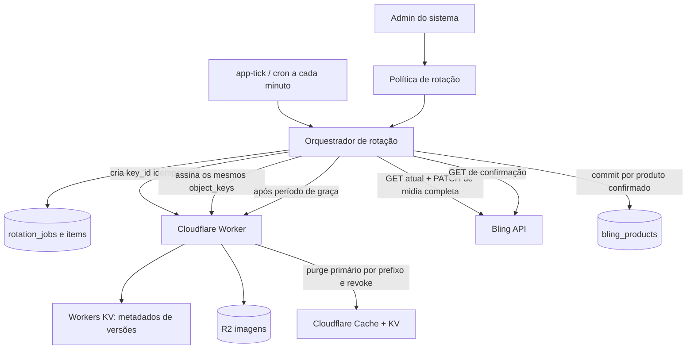

# Plano de arquitetura — rotação de chaves CDN, banco e Bling

Data da análise: 2026-11-18

Status: arquitetura aprovada e implementada localmente no código em 2026-11-18.
A migration ainda não foi aplicada, o Worker não foi publicado e nenhuma
rotação de credencial ou chamada de produção ao Bling/Cloudflare foi executada.

Revisão técnica de 2026-11-18: a ativação em produção continua condicionada ao
piloto. A implementação incorpora quatro gates obrigatórios:
canonicalização HMAC sem ambiguidade, purge Cloudflare comprovado, piloto de
PATCH de mídia no Bling e decisão explícita sobre marketplaces externos. O
agendamento periódico também deixa de ter 90 dias como padrão automático.

## 1. Decisão de escopo

Neste plano, “chave que aparece nos links” significa a chave de assinatura das
URLs públicas de imagens, atualmente representada por `cdn_<uuid>`.

Ela é diferente de:

- `CLOUDFLARE_WORKER_ADMIN_TOKEN`, usado somente entre o backend e a API
  administrativa do Worker;
- tokens da API Cloudflare e do R2;
- access/refresh tokens OAuth do Bling.

Essas credenciais administrativas também precisam de rotação, mas não devem
alterar URLs de produtos. A automação proposta abaixo é para as chaves das URLs.

## 2. Diagnóstico da arquitetura atual

### Fluxo atual



### Falhas encontradas

1. **Revogação antes da migração dos links.**
   `createSignatureRecord` ativa a chave nova, substitui a coluna da integração e
   desativa imediatamente a antiga. Produtos no banco, no Bling, marketplaces e
   caches ainda podem apontar para a chave antiga, criando indisponibilidade.

2. **O propagador não reconhece versão de chave.**
   `cdn-images.server.ts` classifica como `ja_cdn` qualquer conjunto de URLs que
   comece pelo domínio CDN. Uma URL com chave antiga também é ignorada.

3. **O propagador atualiza o banco, não confirma o Bling.**
   O fluxo altera `url_imagens_externas` e `imagem_principal_url`, porém não cria
   uma operação específica e verificável para atualizar as imagens no Bling.

4. **Uma assinatura abre o bucket inteiro.**
   O token embutido na URL é um bearer compartilhado. Quem recebe um link válido
   pode reutilizar o token com outros nomes de objetos previsíveis. A rotação
   frequente diminui a janela, mas não corrige esse modelo.

5. **KV possui consistência eventual.**
   Uma ativação ou revogação pode levar 60 segundos ou mais para aparecer em
   outros pontos da rede. O código atual pressupõe efeito imediato.

6. **Cache não é invalidado ao revogar.**
   As imagens são devolvidas com cache de uma hora e `stale-while-revalidate` de
   um dia. Uma resposta 200 já armazenada pode continuar acessível após remover a
   chave do KV, dependendo das regras de cache da zona.

7. **Não há histórico nem state machine de rotação.**
   Existe somente uma assinatura na integração. Não há chave `pending`,
   `active`, `grace` e `revoked`, job retomável, itens por produto, aprovação de
   revogação, rollback ou prova de conclusão.

8. **A geração automática de assinatura não é governada.**
   O job de imagens pode criar uma assinatura quando não encontra uma ativa,
   fora de uma política de segurança e sem registrar uma rotação.

9. **Usar a fila genérica de produto seria perigoso.**
   A função existente de enqueue limpa tipos da fila por empresa e monta o
   payload completo. A rotação deve ter uma fila de imagens dedicada, sem apagar
   outros trabalhos e sem reenviar campos que não mudaram.

10. **Segredos estão versionados.**
    `.env` está rastreado pelo Git e contém valores não vazios para credenciais
    privilegiadas. Tokens Cloudflare que nem são usados pelo código também estão
    presentes. A primeira entrega precisa revogar esses valores, remover `.env`
    do índice em um commit normal e usar secrets do ambiente. Não se recomenda
    force-push/rewrite do histórico conectado ao Lovable; a revogação torna o
    histórico antigo inofensivo.

## 3. Arquitetura recomendada

### 3.1 URL v2 com assinatura por objeto

Formato proposto:

```text
https://cdn.dominio/v2/{key_id}/{object_signature}/{object_key_b64url}
```

O bucket deixa de ser entrada pública: o Worker acessa um binding R2 fixo. A
chave exata do objeto é convertida de bytes UTF-8 para Base64URL sem padding.
Assim, `/`, `%`, `+`, pontos e caracteres Unicode nunca participam da divisão do
path. Não haverá normalização Unicode: chaves R2 em NFC e NFD podem representar
objetos diferentes.

O handler público aceita exatamente três segmentos depois de `/v2`, aplica
alfabetos e tamanhos estritos, decodifica UTF-8 em modo fatal, recodifica e exige
igualdade byte a byte com a entrada. Padding, codificação não canônica, segmento
vazio, bytes inválidos e chaves excessivamente longas são rejeitados. Requisições
com query string também são rejeitadas para não criar variantes ilimitadas da
chave de cache; fragmentos nunca chegam ao servidor.

`key_id` terá 128 bits aleatórios em Base64URL sem padding. A mensagem do
HMAC-SHA256 será binária e prefixada por tamanho, em vez de concatenada por
separadores:

```text
u16(domain_len) || UTF8("ajustae-cdn-url-v2") ||
u16(key_id_len) || key_id ||
16 bytes de integration_id ||
u32(object_key_len) || object_key_bytes
```

A assinatura usa os 32 bytes completos do HMAC, em Base64URL sem padding, e é
comparada em tempo constante. O endpoint administrativo só assina chaves
obtidas do inventário R2 e confirma sua existência com `head` antes de responder.

Benefícios:

- um link vazado autoriza somente aquele objeto;
- `key_id` pode mudar sem mover os objetos no R2;
- não há segredo no banco, na URL ou no portal;
- a mesma imagem pode receber assinaturas diferentes por integração;
- o Worker continua suportando URLs v1 durante a migração.

O Worker mantém um segredo mestre em `CDN_SIGNING_MASTER_CURRENT` e deriva a
chave de cada `key_id`, vinculando também a integração. Metadados sem segredo
ficam no KV:

```json
{
  "integration_id": "uuid",
  "status": "pending|active|grace|revoked",
  "activated_at": "timestamp",
  "retire_after": "timestamp"
}
```

Para rotacionar o próprio segredo mestre, o Worker aceita temporariamente
`CURRENT` e `PREVIOUS`. Essa é uma operação de infraestrutura separada.

### 3.2 Componentes



### 3.3 Tabelas propostas

#### `cdn_rotation_settings`

Uma política global administrada apenas por `user_roles.role = 'admin'`, com
possível override por integração no futuro:

- `mode`: `manual`, `event_driven` ou `periodic`;
- `enabled` — desabilitado por padrão no piloto;
- `interval_days` — aplicável somente a `periodic`; referência inicial de 365
  dias, configurável entre 30 e 730 após aprovação de risco;
- `grace_days` — mínimo administrativo, não autorização automática para revogar;
  a revogação depende dos gates de consumidores e tráfego;
- `start_hour`, `timezone`;
- `max_bling_requests_per_second` — recomendado: 2, reservando capacidade do
  limite oficial de 3/s para outras operações;
- `max_products_per_day`;
- `require_revoke_approval` — recomendado: `true` no primeiro rollout;
- `next_run_at`, `updated_by`, `updated_at`.

#### `cdn_key_versions`

- `id`, `integration_id`, `key_id`, `generation`;
- `status`: `pending`, `active`, `grace`, `revoked`, `failed`;
- `cloudflare_confirmed_at`, `activated_at`, `retire_after`, `revoked_at`;
- `created_by`, `rotation_job_id`;
- unicidade por `key_id` e apenas uma versão `active` por integração.

#### `cdn_key_rotation_jobs`

- snapshot completo da política usada;
- estados: `planned`, `activating`, `stabilizing`, `preparing`, `pushing`,
  `verifying`, `grace`, `awaiting_revoke`, `revoking`, `completed`, `paused`,
  `failed`, `cancelled`, `rolling_back`, `rolled_back`;
- contadores, lease token, heartbeat, próxima execução, erro seguro;
- `old_key_version_id`, `new_key_version_id`.

#### `cdn_key_rotation_items`

- `job_id`, `company_id`, `integration_id`, `product_id`, `bling_product_id`;
- `old_urls`, `new_urls`, `object_keys`;
- hashes da URL e da versão do produto no momento do snapshot;
- estados por produto: `pending`, `cdn_validated`, `bling_sent`,
  `bling_verified`, `db_committed`, `conflict`, `error`, `rolled_back`;
- tentativas, próximo retry, status HTTP, erro sanitizado e timestamps;
- `UNIQUE(job_id, product_id)` para idempotência.

As tabelas ficam com RLS: administradores globais podem configurar e operar;
membros da empresa podem, no máximo, consultar progresso sanitizado caso isso
seja desejado.

## 4. State machine de uma rotação

1. **Planejar**
   - verificar integração conectada e ausência de outro job ativo;
   - calcular quantidade, chamadas e janela estimada;
   - registrar snapshot da política.

2. **Criar chave nova no Cloudflare**
   - `POST /__admin/key-versions` com idempotency key do job;
   - chave nasce como `pending`;
   - provar que o Worker assina e entrega um objeto de teste.

3. **Estabilizar KV**
   - ativar nova versão sem revogar a antiga;
   - aguardar no mínimo dois minutos e executar probes com objetos-canário
     exclusivos, sem query string;
   - se falhar, apagar somente a chave nova e encerrar sem afetar links atuais.

4. **Trocar a versão corrente para novos cadastros**
   - novos produtos passam a usar a chave nova;
   - produtos antigos continuam funcionando com a chave anterior em `grace`.

5. **Preparar produtos em lotes**
   - selecionar somente URLs do CDN que usam a chave antiga;
   - decodificar canonicamente e preservar exatamente os mesmos `object_keys` e
     a ordem;
   - manter URLs externas ou de outras versões sem alteração;
   - gerar URLs v2 pelo endpoint administrativo de assinatura em lote;
   - validar `HEAD` de cada URL nova antes do envio ao Bling.

6. **Atualizar Bling com mídia completa e mudança mínima**
   - usar fila dedicada, sem chamar `enqueue_bling_push` genérico;
   - executar `GET /produtos/{id}` e obter a mídia corrente imediatamente antes
     da alteração;
   - montar `midia` completo com o vídeo atual e as novas `imagensURL`, porque o
     schema aninhado oficial exige `video` e `imagens`;
   - enviar `PATCH /produtos/{id}` somente com o objeto `midia` validado;
   - usar o limitador compartilhado já existente por empresa;
   - trabalhar a 2 req/s por conta, respeitar `Retry-After` e backoff;
   - pausar automaticamente em 401/403, limite diário ou falha sistêmica.

7. **Confirmar e só então gravar o banco**
   - consultar o produto no Bling e comparar URLs normalizadas;
   - em uma transação, confirmar que o produto não mudou desde o snapshot;
   - atualizar `url_imagens_externas`, `imagem_principal_url` e a seção `midia`
     de `bling_last_sent_payload`;
   - se houver alteração concorrente, marcar `conflict` e refazer o item com o
     estado mais recente, sem sobrescrever o usuário.

8. **Período de graça**
   - ambas as versões continuam válidas;
   - retries e conflitos são resolvidos;
   - a revogação é bloqueada enquanto existir qualquer item não confirmado,
     URL antiga no banco, produto não verificável no Bling ou consumidor externo
     aprovado ainda usando a versão antiga.

9. **Revogar**
   - aprovação manual no primeiro rollout;
   - mudar a chave antiga para `revoking`, impedindo novos misses de gerar 200;
   - purgar globalmente o prefixo `cdn.dominio/v2/{key_id}/` no formato exigido
     pela API Cloudflare;
   - tratar HTTP 200 da API de purge apenas como aceite, não como conclusão;
   - testar URLs-canário antigas até obter 403/404 sem `CF-Cache-Status: HIT` e
     confirmar que as novas continuam retornando 200;
   - marcar a chave antiga como `revoked` e repetir o purge defensivamente;
   - concluir o job e calcular a próxima rotação.

## 5. Cloudflare Worker v2

### API administrativa

- `POST /__admin/key-versions` — cria metadado de versão idempotente;
- `POST /__admin/key-versions/{key_id}/activate`;
- `POST /__admin/key-versions/{key_id}/grace`;
- `DELETE /__admin/key-versions/{key_id}` — revoga, nunca usado antes da prova;
- `POST /__admin/sign` — assina uma lista limitada de object keys;
- `GET /__admin/key-versions/{key_id}` — reconciliação do backend;
- `GET /__admin/inventory` — mantido para o job normal de imagens.

Correções adicionais:

- aceitar token administrativo atual e anterior durante sua própria rotação;
- comparação em tempo constante;
- limite de tamanho e quantidade nos bodies;
- logs sem tokens, URLs completas ou object signatures;
- configurar `CLOUDFLARE_ZONE_ID` e um token novo, de menor privilégio, limitado à
  permissão Cache Purge da zona exata;
- usar purge por prefixo como mecanismo primário, pois o próprio path contém o
  `key_id`; `Cache-Tag: cdn-key-{key_id}` fica como índice secundário;
- validar que nenhuma Transform Rule altera o prefixo visto pelo cache; se
  alterar, usar no purge o path pós-transformação;
- registrar o identificador da requisição de purge e verificar canários depois
  do aceite da API;
- manter o handler v1 até a última URL legada ser eliminada.

Purge por prefixo e por tag está disponível nos planos Free, Pro, Business e
Enterprise. Portanto, o plano comercial não bloqueia a proposta. O gate local,
porém, ainda está aberto: o projeto não possui `CLOUDFLARE_ZONE_ID` configurado e
não há evidência de que o token atual tenha a permissão Cache Purge. Credenciais
versionadas não serão reutilizadas para testar isso; será criado um token novo
depois da contenção de segredos.

O KV continuará adequado para leitura global rápida porque o fluxo aceita
consistência eventual: ativa nova chave, espera estabilização e mantém a antiga.
Não se deve exigir troca atômica de duas chaves no KV.

## 6. Bling, mídia e marketplaces

O Bling documenta atualmente 3 requisições por segundo e 120.000 por dia por
conta. A rotação usará 2 req/s, compartilhadas com o limitador do projeto.

No modo de verificação completa serão aproximadamente duas chamadas por produto:

```text
PATCH da mídia + GET de confirmação
```

Tempo mínimo teórico por empresa:

```text
quantidade_de_produtos * 2 / 2 requisições_por_segundo
```

Isso não inclui retries, outras automações nem pausas. O painel deve exibir a
estimativa antes de iniciar e impedir que o planejamento ultrapasse o orçamento
diário configurado.

O uso de `PATCH` é obrigatório para preservar propriedades de nível superior
que não forem enviadas. Entretanto, o OpenAPI oficial mostra uma restrição
importante: em `ProdutosDadosPatchDTO`, o campo `midia` referencia
`ProdutosMidiaDTO`, cujo objeto exige tanto `video` quanto `imagens`.
`imagens.imagensURL` é write-only e cada item exige `link`.

Por isso, não está aprovado enviar apenas
`{"midia":{"imagens":...}}`. O piloto deverá:

1. obter o produto imediatamente antes do PATCH;
2. guardar um snapshot completo e o vídeo atual;
3. montar o objeto `midia` completo aceito pelo schema;
4. fazer o PATCH;
5. executar novo GET e comparar mídia e todos os campos relevantes com o
   snapshot, admitindo mudança somente nas URLs planejadas;
6. testar rollback com o mesmo procedimento.

A homologação precisa cobrir vídeo preenchido, vídeo vazio, múltiplas imagens e
produto alterado concorrentemente. Somente depois desse teste o formato exato do
payload será congelado.

### 6.1 Marketplaces externos

Atualizar o cadastro do produto no Bling **não garante** atualizar anúncios já
publicados em marketplaces. A própria documentação do Bling informa que:

- nem todos os canais aceitam exportação de imagens;
- é preciso habilitar a exportação e reexportar/sincronizar em alguns canais;
- algumas plataformas não substituem a imagem antiga automaticamente;
- Mercado Livre e Amazon possuem fluxos específicos de sincronização ou
  reexportação.

O escopo inicial será, portanto, `Cloudflare + banco + cadastro do produto no
Bling`. Marketplaces entram em uma fase separada, com inventário por canal,
adaptador, teste e confirmação próprios. No piloto serão usados produtos sem
anúncios externos ou produtos cujo canal seja verificado explicitamente. Uma
chave antiga não poderá ser revogada enquanto existir consumidor externo
declarado ainda apontando para ela.

## 7. Falhas, cancelamento e rollback

- repetição de tick não duplica itens nem versões;
- crash após PATCH e antes do commit é recuperado por GET no Bling;
- 429/5xx usam backoff; 400 vira erro de produto; 401/403 pausa a integração;
- objeto ausente no R2 bloqueia somente aquele produto e impede revogação;
- cancelar antes da revogação apenas pausa o fluxo e mantém as duas chaves;
- rollback é uma operação separada que reenvia `old_urls`, confirma o Bling,
  restaura o banco e só depois revoga a chave nova;
- a chave antiga nunca é revogada com itens `error`, `conflict` ou não
  verificados;
- um watchdog no `app-tick` retoma jobs sem heartbeat;
- no máximo um job por integração e um número pequeno de empresas em paralelo.

## 8. Painel do administrador

Adicionar uma seção “Segurança da CDN” em `/admin`, visível somente a
administradores globais:

- ativar/desativar rotação;
- modo manual/event-driven/periódico, intervalo quando aplicável, período mínimo
  de graça, horário, timezone e orçamento de requisições;
- próxima rotação e última rotação bem-sucedida;
- versão ativa, versão em graça e idade — sem mostrar segredo;
- “Simular”, “Rotacionar agora”, “Pausar”, “Retomar”, “Cancelar”, “Rollback” e
  “Aprovar revogação”;
- progresso por fase e empresa;
- relatório de produtos confirmados, conflitos e erros;
- trilha de auditoria com ator, data e motivo.

Alterar a política, iniciar manualmente, fazer rollback e aprovar revogação
exigirão confirmação explícita e serão auditados.

## 9. Segurança imediata antes da implementação

Entrega zero, bloqueadora:

1. inventariar e revogar credenciais reais presentes no `.env` versionado;
2. remover do runtime os tokens Cloudflare/R2 que o código não utiliza;
3. criar `.env.example` sem valores e ignorar `.env`;
4. retirar `.env` do índice em commit normal;
5. guardar secrets no ambiente de deploy/Cloudflare, com menor privilégio;
6. ativar secret scanning no repositório;
7. não reescrever o histórico publicado conectado ao Lovable sem uma operação
   separada e expressamente aprovada.

Os nomes que exigem tratamento prioritário incluem a chave service role do
Supabase, chave do provedor de IA, tokens Cloudflare/R2, token administrativo do
Worker e segredo dos workers internos. Chaves publishable não são secretas, mas
também não devem compartilhar o mesmo arquivo de credenciais privilegiadas.

## 10. Plano incremental de implementação

### Fase 0 — contenção de segredos

- revogação, secrets do ambiente, `.gitignore` e arquivo de exemplo;
- critério: nenhum segredo privilegiado rastreado e tokens antigos inválidos.

### Fase 1 — schema e state machine

- migrations, RLS, claims atômicos, leases, jobs e auditoria;
- nenhuma automação ativa por padrão;
- critério: testes de concorrência e retomada passam.

### Fase 2 — Worker v2 compatível com v1

- HMAC por objeto com codificação canônica, versões, endpoints idempotentes e
  purge primário por prefixo;
- critério: v1 permanece funcionando; v2 rejeita mudança de object key e uma
  chave revogada após purge verificado por canários.

### Fase 3 — backend em dry-run

- inventário de URLs, estimativa, geração/HEAD sem alterar banco ou Bling;
- critério: relatório cobre 100% dos produtos e não contém objeto inexistente.

### Fase 4 — piloto manual

- um ambiente/empresa autorizado: 10 produtos, depois 100, depois o restante;
- sem agendamento e sem revogação baseada apenas em prazo;
- critério: Bling e banco confirmados, campos não relacionados preservados, zero
  URL quebrada, consumidores externos inventariados e rollback testado.

### Fase 5 — agendamento

- habilitar a configuração de intervalo no admin;
- começar em modo `manual/event_driven`; se a organização exigir um
  criptoperíodo, usar inicialmente revisão anual, não rotação cega a cada 90
  dias;
- alertar aos 330 dias e permitir planejar a rotação aos 365 dias;
- critério: o ciclo agendado chega a `awaiting_revoke` sem intervenção e o
  administrador aprova somente após revisar todos os gates.

### Fase 6 — canais externos opcionais

- um conector e uma estratégia de verificação para cada marketplace autorizado;
- critério: anúncio externo confirmado com a URL nova ou exceção registrada que
  mantenha a chave antiga em graça.

## 11. Testes obrigatórios

- unidade: Base64URL estrito, UTF-8 fatal, mensagens HMAC prefixadas por tamanho,
  parser v1/v2, substituição parcial e estados;
- vetores adversariais: slash codificado e duplamente codificado, `%`, `+`,
  padding, segmento vazio, pontos, NUL, UTF-8 inválido, chave longa, troca de
  maiúsculas/minúsculas, NFC/NFD e alteração isolada de `key_id`, chave ou HMAC;
- Worker: autorização, manipulação do path, KV atrasado, cache e purge;
- banco: RLS, claim concorrente, lease expirado, idempotência e contadores;
- Bling: GET, PATCH de `midia` completa e GET de confirmação sem alterar outros
  campos, incluindo vídeo preenchido e vazio;
- canais: ao menos um teste explícito por marketplace antes de incluí-lo no
  gate de revogação;
- E2E: 429, 500, 401, objeto R2 ausente, conflito de edição, tick duplicado,
  crash entre Bling e banco, cancelamento, retomada e rollback;
- segurança: token v2 de uma imagem não abre outra imagem e logs não vazam
  assinatura nem credencial.

## 12. Decisões solicitadas para aprovação

Recomendação revisada:

1. aprovar URL v2 com HMAC por objeto, em vez de manter bearer por bucket;
2. aprovar o contrato canônico de path e mensagem HMAC descrito na seção 3.1;
3. não aprovar 90 dias como padrão: iniciar em `manual/event_driven` e decidir
   separadamente se haverá revisão periódica anual;
4. tratar prazo de graça como mínimo, nunca como prova suficiente para revogar;
5. aprovar purge por prefixo, condicionado ao novo token, zone ID e canários;
6. executar piloto do payload completo de mídia e comparar o produto antes e
   depois;
7. limitar a primeira entrega a Cloudflare, banco e Bling; decidir quais
   marketplaces entrarão na fase 6;
8. manter 2 requisições/s por conta e revogação manual nos primeiros ciclos;
9. executar primeiro a contenção do `.env` versionado;
10. escolher uma empresa e até 10 produtos sem anúncios externos para o piloto.

## 13. Fontes externas verificadas

- Cloudflare Workers KV é eventualmente consistente e alterações podem levar
  60 segundos ou mais para aparecer globalmente:
  <https://developers.cloudflare.com/kv/concepts/how-kv-works/>
- Cloudflare disponibiliza purge por URL, hostname, tag e prefixo em todos os
  planos, com limites diferentes por plano:
  <https://developers.cloudflare.com/cache/how-to/purge-cache/>
- Purge por tag e seus requisitos:
  <https://developers.cloudflare.com/cache/how-to/purge-cache/purge-by-tags/>
- API de purge e validação posterior da resposta no cache:
  <https://developers.cloudflare.com/api/resources/cache/methods/purge/>
- Semântica e configuração de cache de Workers:
  <https://developers.cloudflare.com/workers/cache/configuration/>
- Boas práticas do Bling para PUT versus PATCH:
  <https://developer.bling.com.br/boas-praticas>
- Referência e OpenAPI oficial usados para validar o schema de PATCH de produto
  e os requisitos do objeto `midia`:
  <https://developer.bling.com.br/referencia>
- Limites atuais da API Bling:
  <https://developer.bling.com.br/limites>
- Exportação de imagens do Bling para canais de venda e suas limitações:
  <https://ajuda.bling.com.br/hc/pt-br/articles/4416283734039-Como-adicionar-as-imagens-do-meu-produto-na-Loja-Virtual>
- Sincronização de anúncios existentes no Mercado Livre:
  <https://ajuda.bling.com.br/hc/pt-br/articles/34346724609687-Como-editar-an%C3%BAncios-j%C3%A1-enviados-ao-Mercado-Livre-pelo-Bling>
- Atualização de imagens na Amazon mediante reexportação:
  <https://ajuda.bling.com.br/hc/pt-br/articles/43759577772567--Atualiza%C3%A7%C3%B5es-da-vers%C3%A3o-Envio-de-imagens-para-produtos-j%C3%A1-cadastrados-na-Amazon>
